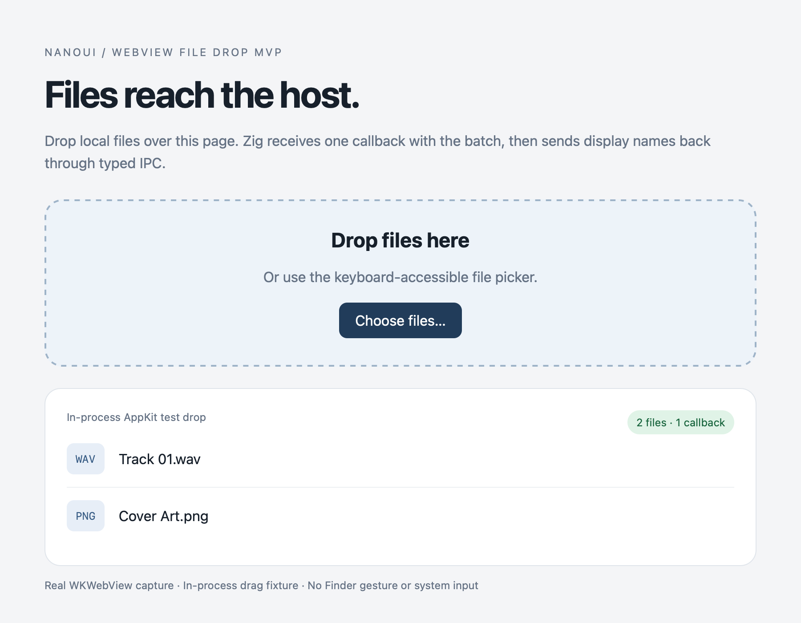

# Webview host file drops (macOS MVP)

```zig
.content = .{ .page = .{
    .url = "/",
    .assets = &assets,
    .file_drop = .{ .ctx = &state, .on_drop = State.dropped },
} },

fn dropped(raw: ?*anyopaque, event: nanoui.PageFileDrop) void {
    const state: *State = @ptrCast(@alignCast(raw.?));
    // event.urls are file URLs, not decoded filesystem paths.
    // Copy any URLs retained after this callback returns.
    state.importFiles(event.urls);
}
```

Opting in gives the host copy-only ownership of local-file drops over the
whole page, including a docked page. It gets one batch on the UI thread;
WebKit does not also navigate or upload that consumed batch. Null preserves
WebKit behavior. Non-file drops retain WebKit handling. Mixed batches deliver
the local file URLs and consume the batch. A source that does not offer a copy
operation is left to WebKit. Hover does not call the import callback.

`event.point` is top-left page-view-local logical points, not DOM/CSS pixels
or screen pixels. Slices live until callback return. The handler context must outlive the page;
no new callback starts after teardown. Copying a URL does not
extend platform access permissions. The callback may close its window; queued
flushes and reentrant callbacks must not free its Page storage prematurely.

`nanoui.page_file_drop_supported` is true only on macOS. Windows, Linux and
iOS page creation returns `FileDropsUnsupported` when the handler is enabled.
Android still returns `PagesUnsupported` for any page content. Native UI's
`acceptDrop` / `dropAt` are unchanged.

## Limits and follow-up work

This is a first milestone for #211, not full platform parity. It does not
include per-region acceptance, host rejection/hover callbacks, file promises,
async materialization, access leases, outbound file exports or new native-UI
host adapters. UIKit and Android cannot be treated as synchronous path lists.

DVUI's [SDL drop proposal](https://github.com/david-vanderson/dvui/pull/922)
is related precedent for external drop lifecycle/ownership. This integration
keeps OS drops separate from synthetic mouse presses/releases and retains
nanoui's batch-of-URLs convention. It adds no SDL dependency or copied code.

## Demo and evidence

```sh
zig build page-drop -Dllvm=true -j1
python3 tools/page-drop-demo.py --out /tmp/page-drop.png
```

The regular example accepts OS file drops and offers a file-picker button.
The hidden script uses temporary files and private in-process AppKit drag
objects to invoke the real WKWebView destination methods. The host emits only
display names through typed IPC, then the actual WKWebView is snapshotted.
The PNG explicitly identifies the fixture. This verifies callback-to-page
behavior, not Finder/WindowServer drag negotiation. No system pasteboard,
mouse/keyboard injection, user files or screen capture is used.



Real hidden WKWebView after private in-process AppKit drag input; not a Finder gesture.
