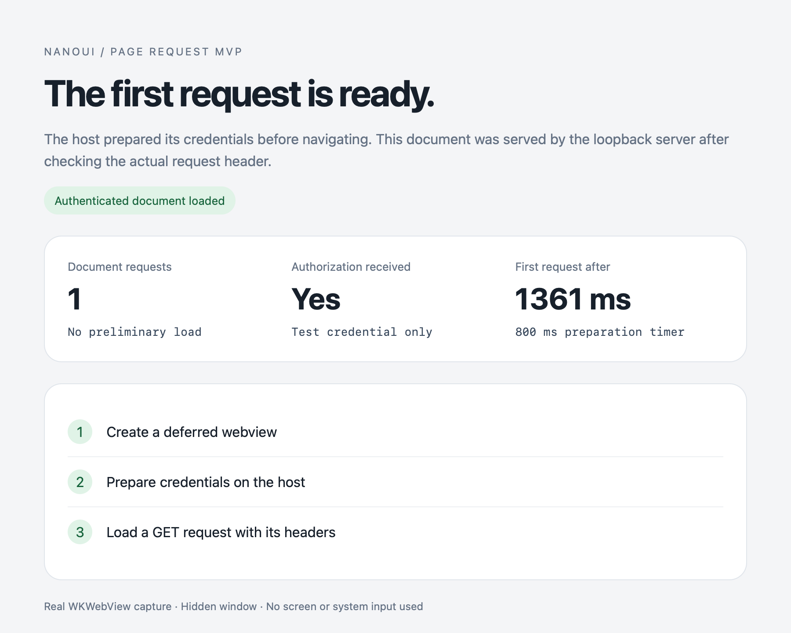

# Deferred page requests (MVP)

Create a webview without loading the configured URL:

```zig
const w = try app.newWindow(.{ .content = .{ .page = .{
    .url = "https://example.test/app",
    .defer_initial_load = true,
} } });
// On the UI thread, after obtaining credentials:
try w.loadPageRequest(.{
    .url = "https://example.test/app",
    .headers = &.{.{ .name = "Authorization", .value = token }},
});
```

`PageRequest` is a GET and optional `PageHeader` entries. It applies to
that navigation, not every subsequent resource. `setPageUrl` and `Page.load`
remain URL-only conveniences. A native-only window returns `error.NoPage`.
Docked page handles on macOS/Windows also have `loadRequest`.

On Windows, a request arriving before WebView2 is ready is copied; the
latest request replaces the previous one and takes precedence over automatic
startup. An invalid replacement leaves the existing pending request intact.
iOS similarly copies requests submitted before the scene realizes its page.
Closing frees pending requests. Immediate submission errors are returned;
errors when submitting an already-queued request after initialization are
logged by error name. General navigation-completion callbacks are follow-up
work. No worker should retain a raw Window pointer after that window closes.

macOS/iOS use NSMutableURLRequest, Windows uses WebView2's request interface,
and Linux uses WebKitURIRequest with Soup headers. Android still returns
`PagesUnsupported`. A missing WebView2 request interface fails explicitly;
it never retries an authenticated request as a URL-only navigation.

Header names/values reject injection and duplicates. Cookie, Host,
Content-Length, Transfer-Encoding and Connection are not supported. Headers
require an absolute HTTP(S) URL. The caller can release its request bytes when
`loadPageRequest` returns.

## Limits

This MVP does not implement authentication challenges, cookie preparation,
POST bodies, header propagation to subresources, or a redirect policy API.
Redirects use the web engine's behavior. Arbitrary custom headers must not be
used as a cross-origin credential isolation mechanism; origin-restricted
redirect handling remains part of issue #212. Sensitive credentials should not
be sent to endpoints whose redirects are not trusted. The example uses a
loopback server and a test credential only.

## Reproduce the screenshot and network check

```sh
zig build page-request -Dllvm=true -j1
python3 tools/page-request-demo.py --out /tmp/page-request.png
```

The script creates a loopback server, launches the real example with
`--nanoui-hidden`, checks one authenticated document request after preparation
and no Authorization on a later fetch, and snapshots only that WKWebView.
The PNG and adjacent JSON contain the result. No screen capture or system
input is used. Capture is currently macOS-only; the example runs on other
supported page backends with a compatible loopback server.



Real hidden WKWebView; the loopback server verifies the first request.
